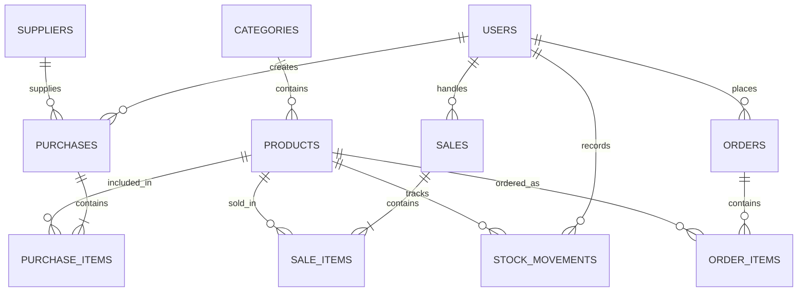

# ERD Stockify

**Sistem Informasi Inventaris dan Transaksi**

## Keterangan Entitas

| Entitas | Fungsi |
|---|---|
| `users` | Menyimpan akun Admin, Staff, dan Customer. |
| `categories` | Menyimpan kategori produk. |
| `products` | Menyimpan data produk dan stok. |
| `suppliers` | Menyimpan data pemasok. |
| `purchases` | Mencatat transaksi pembelian barang. |
| `purchase_items` | Menyimpan rincian barang yang dibeli. |
| `sales` | Mencatat transaksi penjualan. |
| `sale_items` | Menyimpan rincian barang yang dijual. |
| `stock_movements` | Mencatat perubahan stok produk. |
| `orders` | Menyimpan pesanan pelanggan. |
| `order_items` | Menyimpan rincian produk dalam pesanan. |